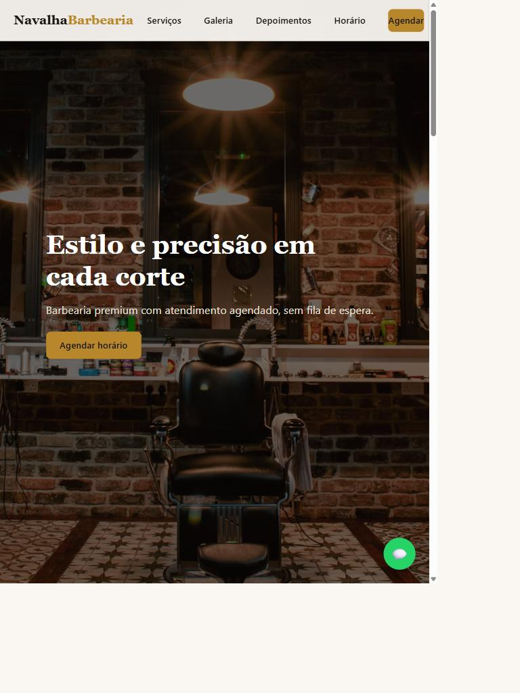
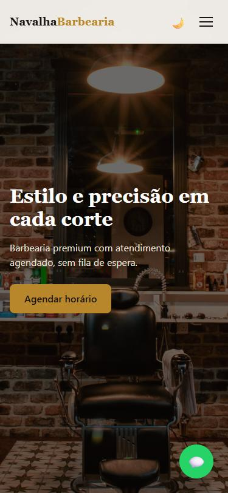
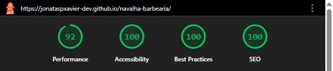

# Navalha Barbearia — Landing Page

Landing page responsiva para uma barbearia **fictícia**, construída como peça de portfólio. HTML, CSS e JavaScript puro, sem frameworks e sem build step.




## Funcionalidades

- Header fixo com menu hambúrguer no mobile
- Hero com chamada para agendamento
- Serviços renderizados a partir de `js/data.js`
- Galeria com lightbox acessível (teclado, setas, ESC) com fotos reais de barbearia
- Carrossel de depoimentos com autoplay, pausa no hover e transição em slide
- Formulário de agendamento com máscara de telefone, calendário customizado (bloqueia datas passadas e dias fechados) e grade de horários disponíveis conforme o expediente do dia, com gravação em `localStorage`
- Horário de funcionamento com status "Aberto agora / Fechado" calculado em tempo real
- Botão flutuante de WhatsApp com pulso sutil
- Modo escuro com preferência salva (respeita `prefers-color-scheme`)
- Animações on-scroll com `IntersectionObserver`, entrada animada do hero e header com sombra ao rolar

## Tecnologias

HTML5 semântico, CSS3 (variáveis, Flexbox, Grid) e JavaScript ES6+. Nenhuma dependência externa além de imagens (fotos de barbearia via Unsplash).

## Qualidade

Auditado com [Lighthouse](https://developer.chrome.com/docs/lighthouse/) direto no site publicado:



| Categoria       | Nota |
| --------------- | ---- |
| Performance     | 92   |
| Acessibilidade  | 100  |
| Boas Práticas   | 100  |
| SEO             | 100  |

Também verificado manualmente: navegação só por teclado, skip link, foco visível e ausência de rolagem horizontal entre 320px e 1920px.

## Como rodar localmente

Qualquer servidor estático funciona. Por exemplo, com Python:

```bash
python -m http.server 8080
```

Depois acesse `http://localhost:8080`.


## Link do deploy

🔗 [jonataspxavier-dev.github.io/navalha-barbearia](https://jonataspxavier-dev.github.io/navalha-barbearia/)
